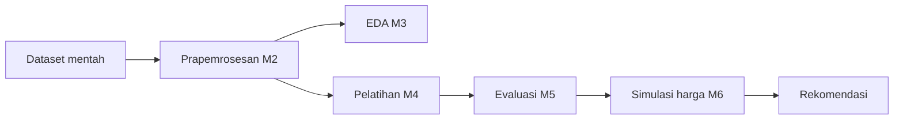

# Laporan Ujian Praktik — Prediksi Permintaan dan Rekomendasi Harga

**Mata kuliah:** Artificial Intelligence dan Machine Learning  
**Program studi:** Teknik Informatika  
**Nama:** Dafa Fawaz Fachriza Rahman  
**NIM:** 247200012  
**Tahun akademik:** 2026/2027

---

## Bab 1 — Judul dan abstrak

Penelitian ini membangun sistem pembelajaran mesin untuk memprediksi **permintaan** produk pada berbagai segmen harga, lalu menurunkan **rekomendasi harga** yang memaksimalkan **pendapatan** (harga × permintaan). Data berupa deret waktu harian yang mensimulasikan harga perusahaan, harga pesaing, diskon, musim liburan, dan jumlah unit terjual.

Metode: (1) profil dan prapemrosesan data; (2) regresi **model dasar (baseline)** Linear Regression dan model lanjutan Random Forest dengan **validasi berbasis waktu**; (3) simulasi grid harga pada skenario konteks tetap. Pada set uji (500 observasi setelah cutoff `2027-06-24`), baseline mencapai MAE 15,74, RMSE 24,59, dan R² 0,968. **Rekomendasi harga:** **126.283 IDR** dengan permintaan prediksi ≈ 513 unit dan pendapatan prediksi ≈ 64,7 juta IDR pada asumsi median latih.

*Perkiraan halaman Word (heuristik ekspor): ≈ 3,7 halaman teks+gambar — verifikasi final di Word (batas 10 halaman).*

---

## Bab 2 — Teori

**Elastisitas harga permintaan** menggambarkan sensitivitas jumlah unit terjual terhadap perubahan harga. Permintaan yang relatif turun ketika harga naik mendukung strategi penetapan harga berbasis data.

Masalah ini diformulasikan sebagai **regresi** dengan target numerik **permintaan**, bukan klasifikasi. **Pendapatan** dihitung terpisah sebagai harga × permintaan untuk keputusan bisnis.

**Model dasar (baseline):** regresi linear dengan penskalaan fitur; mudah diinterpretasi dan menjadi pembanding wajib. **Model lanjutan:** Random Forest untuk menangkap hubungan non-linear antar fitur.

**Validasi berbasis waktu:** data lama untuk latih, data lebih baru untuk uji, menghindari bocoran informasi masa depan ke masa lalu (ADR-0001). Metrik evaluasi: **MAE**, **RMSE**, dan **R²** pada set uji.

**Simulasi harga:** model terlatih dipakai menguji banyak kandidat harga; setiap titik menghasilkan prediksi permintaan dan pendapatan sehingga dapat dipilih titik optimal menurut kriteria yang didefinisikan.

---

## Bab 3 — Rancangan sistem

Alur modul di repositori:



1. Muat CSV; imputasi median (hanya dari latih); fitur `selisih_harga_pesaing` dan `rasio_harga_pesaing`.
2. Latih baseline dan Random Forest; simpan artefak di `outputs/models/`.
3. Bandingkan metrik pada set uji; pilih model untuk simulasi.
4. Grid harga → prediksi permintaan → pendapatan → rekomendasi.

Cuplikan pemisahan latih–uji berwaktu:

```python
train = df.loc[df["tanggal"] < cutoff]
test = df.loc[df["tanggal"] >= cutoff]
```

---

## Bab 4 — Dataset dan prapemrosesan

**Sumber:** `data/raw/synthetic_demand.csv` (2.500 baris, 2022-01-01 s/d 2028-11-04). Generator mengikuti `DATASET_GENERATOR_SPECS.md`.

**Tabel 1.** Ringkasan kolom utama

| Kolom | Peran |
|-------|--------|
| `tanggal` | Urutan waktu, satu baris per hari |
| `harga_produk` | Harga jual (IDR) |
| `harga_pesaing` | Harga kompetitor |
| `persen_diskon` | Diskon (%) |
| `musim_liburan` | Penanda 0/1 |
| `permintaan` | Target regresi (unit) |

Missing terkendali: `harga_pesaing` 1,84% dan `permintaan` 2,4%. Median imputasi dihitung pada **2.000 baris latih** saja, lalu diterapkan ke seluruh data agar statistik uji tidak mempengaruhi latih. Cutoff uji: **2027-06-24** (80% awal = latih).

**Gambar 1.** Hubungan harga produk dan permintaan (warna: musim liburan)


Temuan EDA: korelasi negatif harga–permintaan (r ≈ −0,37); posisi relatif terhadap pesaing penting; permintaan lebih tinggi pada musim liburan.

---

## Bab 5 — Model dan evaluasi

**Fitur masuk model:** `harga_produk`, `harga_pesaing`, `persen_diskon`, `musim_liburan`, `selisih_harga_pesaing`, `rasio_harga_pesaing`. Target: `permintaan`. Seed pelatihan: 42.

**Tabel 2.** Metrik pada set uji (500 baris)

| Model | MAE | RMSE | R² |
|-------|-----|------|-----|
| Linear Regression (baseline) | 15,74 | 24,59 | 0,968 |
| Random Forest | 17,14 | 25,86 | 0,964 |

Baseline sedikit lebih baik pada RMSE; dipilih untuk **simulasi harga** karena lebih interpretable dan setara akurasinya.

**Gambar 2.** Korelasi fitur utama


**Gambar 3.** Perbandingan RMSE baseline vs lanjutan


---

## Bab 6 — Simulasi harga dan rekomendasi

Skenario: `harga_produk` divariasikan pada grid P10–P90 latih (80 titik); `harga_pesaing` ≈ 91.163 IDR, diskon median 10,1%, non-liburan (median latih). Model: baseline linear.

**Tabel 3.** Ringkasan rekomendasi

| Kriteria | Nilai |
|----------|-------|
| Harga rekomendasi | **126.283 IDR** |
| Permintaan prediksi | ≈ 513 unit |
| Pendapatan prediksi | ≈ 64,7 juta IDR |

**Gambar 4.** Kurva permintaan dan pendapatan vs harga (garis putus-putus = titik rekomendasi)


Pada grid yang sama, pendapatan di titik harga terendah ≈ 38,2 juta IDR; rekomendasi memaksimalkan pendapatan pada batas atas grid. Sensitivitas: permintaan prediksi pada grid antara ≈ 513–576 unit.

---

## Bab 7 — Kesimpulan dan keterbatasan

**Kesimpulan:** Sistem berhasil memprediksi permintaan dengan R² tinggi pada set uji dan menghasilkan **rekomendasi harga 126.283 IDR** untuk memaksimalkan pendapatan pada skenario yang dijelaskan. Pipeline modular dapat dijalankan ulang end-to-end dari repositori.

**Keterbatasan:** (1) data sintetis, pola elastisitas mungkin berbeda dari pasar nyata; (2) simulasi memegang konteks non-harga tetap—hasil sensitif terhadap asumsi tersebut; (3) model belajar dari masa lalu sehingga rekomendasi adalah perkiraan, bukan jaminan; (4) korelasi diskon–permintaan sangat kuat pada data sintetis—perlu kehati-hatian interpretasi kausal.

**Reproduksi:** `python -m py_prediction_system.run_pipeline` lalu ekspor laporan `python -m py_prediction_system.reporting.export_docx`.

---

*Catatan halaman: setelah ekspor ke Word (Times New Roman 12 pt, spasi 1,15), verifikasi jumlah halaman ≤ 10. Estimasi tercatat di `report/page_count_estimate.txt`.*